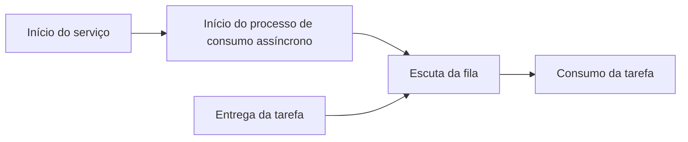

# Fila assíncrona

A fila assíncrona difere de filas de mensagens como `RabbitMQ` e `Kafka`: ela oferece apenas a capacidade de `processamento assíncrono` e `processamento assíncrono com atraso` e **não** garante rigorosamente a persistência das mensagens, além de **não suportar** um mecanismo completo de resposta ACK.

## Instalação

```bash
composer require hyperf/async-queue
```

## Configuração

O arquivo de configuração está localizado em `config/autoload/async_queue.php`. Caso esse arquivo não exista, você pode usar o comando `php bin/hyperf.php vendor:publish hyperf/async-queue` para publicar o arquivo de configuração correspondente.

> No momento, apenas o driver `Redis Driver` é suportado.

|       Configuração       |   Tipo    |                 Valor padrão                |                       Observação                        |
| :--------------: | :-------: | :-----------------------------------------: | :-------------------------------------: |
|      enable      |   bool    |                    false                    |           Cria automaticamente o processo de consumo              |
|      driver      |  string   | Hyperf\AsyncQueue\Driver\RedisDriver::class |                   Nenhum                    |
|     channel      |  string   |                    queue                    |                Prefixo da fila                 |
|    redis.pool    |  string   |                   default                   |              Pool de conexões redis               |
|     timeout      |    int    |                      2                      |           Tempo limite para o pop de mensagens            |
|  retry_seconds   | int,array |                      5                      |           Intervalo de nova tentativa após falha            |
|  handle_timeout  |    int    |                     10                      |            Tempo limite de processamento da mensagem             |
|    processes     |    int    |                      1                      |               Número de processos de consumo                |
| concurrent.limit |    int    |                     10                      |             Quantidade de mensagens processadas simultaneamente              |
|   max_messages   |    int    |                      0                      | Número máximo de mensagens processadas antes da reinicialização do processo; por padrão, não reinicia |

```php
<?php

return [
    'default' => [
        'enable' => true,
        'driver' => Hyperf\AsyncQueue\Driver\RedisDriver::class,
        'redis' => [
            'pool' => 'default'
        ],
        'channel' => 'queue',
        'timeout' => 2,
        'retry_seconds' => 5,
        'handle_timeout' => 10,
        'processes' => 1,
        'concurrent' => [
            'limit' => 10,
        ],
        'max_messages' => 0,
    ],
];

```

`retry_seconds` também pode receber um array, ajustando o tempo de nova tentativa conforme o número de tentativas, por exemplo

```php
<?php

return [
    'default' => [
        'enable' => true,
        'driver' => Hyperf\AsyncQueue\Driver\RedisDriver::class,
        'channel' => 'queue',
        'retry_seconds' => [1, 5, 10, 20],
        'processes' => 1,
    ],
];

```

## Como funciona

`ConsumerProcess` é o processo de consumo assíncrono, que executa a lógica de consumo de acordo com o `Job` criado pelo usuário ou com o bloco de código que usa `#[AsyncQueueMessage]`.
Tanto `Job` quanto `#[AsyncQueueMessage]` são tarefas que precisam ser entregues e executadas, ou seja, os dados e a lógica de consumo são definidos na tarefa.

- As variáveis de membro na classe `Job` são os dados a serem consumidos, e o método `handle()` é a lógica de consumo.
- No método anotado com `#[AsyncQueueMessage]`, os dados passados no construtor são os dados a serem consumidos, e o corpo do método é a lógica de consumo.



## Uso

### Configurar o processo de consumo assíncrono

O componente oferece duas formas de configurar o processo de consumo assíncrono: `configuração de processo` e `configuração de parâmetros`.

#### 1. Configuração de parâmetros

De acordo com o parâmetro `enable` no arquivo de configuração `config/autoload/async_queue.php` mencionado acima, o processo de consumo é criado automaticamente.

#### 2. Configuração de processo

O componente já fornece o `processo de consumo assíncrono` padrão; basta configurá-lo em `config/autoload/processes.php`.

```php
<?php

return [
    Hyperf\AsyncQueue\Process\ConsumerProcess::class,
];

```

Naturalmente, você também pode adicionar o seguinte `Process` ao seu próprio projeto.

> A configuração e a anotação são alternativas: escolha apenas uma.

```php
<?php

declare(strict_types=1);

namespace App\Process;

use Hyperf\AsyncQueue\Process\ConsumerProcess;
use Hyperf\Process\Annotation\Process;

#[Process(name: "async-queue")]
class AsyncQueueConsumer extends ConsumerProcess
{
}
```

### Como usar múltiplas configurações

Alguns desenvolvedores criam múltiplas configurações em cenários especiais, por exemplo, quando algumas mensagens precisam ser processadas com prioridade e, por isso, são colocadas em uma fila mais ociosa. Exemplo de configuração:

```php
<?php

return [
    'default' => [
        'enable' => true,
        'driver' => Hyperf\AsyncQueue\Driver\RedisDriver::class,
        'redis' => [
            'pool' => 'default'
        ],
        'channel' => 'queue',
        'timeout' => 2,
        'retry_seconds' => 5,
        'handle_timeout' => 10,
        'processes' => 1,
        'concurrent' => [
            'limit' => 5,
        ],
    ],
    'fast' => [
        'enable' => true,
        'driver' => Hyperf\AsyncQueue\Driver\RedisDriver::class,
        'redis' => [
            'pool' => 'default'
        ],
        'channel' => '{queue:fast}',
        'timeout' => 2,
        'retry_seconds' => 5,
        'handle_timeout' => 10,
        'processes' => 1,
        'concurrent' => [
            'limit' => 5,
        ],
    ],
];

```

Porém, nosso `Hyperf\AsyncQueue\Process\ConsumerProcess` padrão processa apenas a configuração `default`, então precisamos criar um novo `Process`

```php
<?php

declare(strict_types=1);

namespace App\Process;

use Hyperf\AsyncQueue\Process\ConsumerProcess;
use Hyperf\Process\Annotation\Process;

#[Process(name: "async-queue")]
class AsyncQueueConsumer extends ConsumerProcess
{
    protected string $queue = 'fast';
}
```

### Produzir mensagens

#### Forma tradicional

Esse modo serializa o objeto diretamente e o armazena em uma fila como o `Redis`, portanto, para garantir o tamanho após a serialização, evite definir `Container`, `Config` etc. como variáveis de membro.

Por exemplo, a definição de `Job` abaixo é **inadequada**, e o mesmo vale para `#[Inject]`.

> Como o Job será serializado, as variáveis de membro não devem conter funções anônimas ou outros conteúdos que não possam ser serializados. Se não souber quais conteúdos não podem ser serializados, prefira usar a forma de anotação.

```php
<?php

declare(strict_types=1);

namespace App\Job;

use Hyperf\AsyncQueue\Job;
use Psr\Container\ContainerInterface;

class ExampleJob extends Job
{
    public $container;

    public $params;

    public function __construct(ContainerInterface $container, $params)
    {
        $this->container = $container;
        $this->params = $params;
    }

    public function handle()
    {
        // Processa a lógica concreta de acordo com os parâmetros
        var_dump($this->params);
    }
}

$job = make(ExampleJob::class);
```

O `Job` correto deve conter apenas os dados que precisam ser processados; outros dados relacionados podem ser obtidos novamente no método `handle`, como abaixo.

```php
<?php

declare(strict_types=1);

namespace App\Job;

use Hyperf\AsyncQueue\Job;

class ExampleJob extends Job
{
    public $params;
    
    /**
     * Número de novas tentativas após a falha na execução da tarefa, ou seja, o número máximo de execuções é $maxAttempts+1
     */
    protected int $maxAttempts = 2;

    public function __construct($params)
    {
        // Aqui é melhor usar dados comuns; não use objetos que carregam IO, como objetos PDO
        $this->params = $params;
    }

    public function handle()
    {
        // Processa a lógica concreta de acordo com os parâmetros
        // Obtém modelos etc. por meio de parâmetros concretos
        // A lógica aqui será executada no processo ConsumerProcess
        var_dump($this->params);
    }
}
```

Depois de definir corretamente o `Job`, precisamos escrever um `Service` dedicado à entrega de mensagens, com o código abaixo.

```php
<?php

declare(strict_types=1);

namespace App\Service;

use App\Job\ExampleJob;
use Hyperf\AsyncQueue\Driver\DriverFactory;
use Hyperf\AsyncQueue\Driver\DriverInterface;

class QueueService
{
    protected DriverInterface $driver;

    public function __construct(DriverFactory $driverFactory)
    {
        $this->driver = $driverFactory->get('default');
    }

    /**
     * Produz uma mensagem.
     * @param $params Dados
     * @param int $delay Tempo de atraso em segundos
     */
    public function push($params, int $delay = 0): bool
    {
        // O `ExampleJob` aqui será serializado e armazenado no Redis, então as variáveis internas devem conter apenas dados comuns
        // Da mesma forma, se a anotação @Value for usada internamente, o objeto correspondente também será serializado, aumentando o corpo da mensagem.
        // Por isso, também não é recomendado usar o método `make` para criar o objeto `Job` aqui.
        return $this->driver->push(new ExampleJob($params), $delay);
    }
}
```

Entregar a mensagem

Em seguida, basta chamar nosso `QueueService` para entregar a mensagem.

```php
<?php

declare(strict_types=1);

namespace App\Controller;

use App\Service\QueueService;
use Hyperf\Di\Annotation\Inject;
use Hyperf\HttpServer\Annotation\AutoController;

#[AutoController]
class QueueController extends AbstractController
{
    #[Inject]
    protected QueueService $service;

    /**
     * Entrega de mensagem no modo tradicional
     */
    public function index()
    {
        $this->service->push([
            'group@hyperf.io',
            'https://doc.hyperf.io',
            'https://www.hyperf.io',
        ]);

        return 'success';
    }
}
```

#### Forma de anotação

Além da forma tradicional de entrega de mensagens, o framework também oferece a forma de anotação.

> A forma de anotação entrega automaticamente a mensagem na fila em ambientes que não são de consumo; portanto, se usarmos a forma de anotação dentro da fila, a mensagem não será entregue novamente à fila, mas executada diretamente neste processo de consumo.
> Se ainda for necessário entregar mensagens na fila dentro da fila, use o modo tradicional de entrega na fila.

Vamos reescrever o `QueueService` acima, movendo diretamente a lógica de `ExampleJob` para o método `example` e adicionando a anotação correspondente `AsyncQueueMessage`, com o código abaixo.

```php
<?php

declare(strict_types=1);

namespace App\Service;

use Hyperf\AsyncQueue\Annotation\AsyncQueueMessage;

class QueueService
{
    #[AsyncQueueMessage]
    public function example($params)
    {
        // Lógica de código que precisa ser executada de forma assíncrona
        // A lógica aqui será executada no processo ConsumerProcess
        var_dump($params);
    }
}

```

Entregar a mensagem

Na forma de anotação, a entrega da mensagem é igual a uma chamada normal de método, com o código abaixo.

```php
<?php

declare(strict_types=1);

namespace App\Controller;

use App\Service\QueueService;
use Hyperf\Di\Annotation\Inject;
use Hyperf\HttpServer\Annotation\AutoController;

#[AutoController]
class QueueController extends AbstractController
{
    #[Inject]
    protected QueueService $service;

    /**
     * Entrega de mensagem no modo de anotação
     */
    public function example()
    {
        $this->service->example([
            'group@hyperf.io',
            'https://doc.hyperf.io',
            'https://www.hyperf.io',
        ]);

        return 'success';
    }
}
```

### Scripts padrão

Arguments:
  - queue_name: nome da configuração da fila, o padrão é default

Options:
  - channel_name: nome da fila, por exemplo, a fila de falhas failed, a fila de timeout timeout

#### Exibir o status das mensagens da fila atual

```shell
$ php bin/hyperf.php queue:info {queue_name}
```

#### Recarregar todas as mensagens com falha/timeout para a fila de espera de execução

```shell
php bin/hyperf.php queue:reload {queue_name} -Q {channel_name}
```

#### Destruir todas as mensagens com falha/timeout

```shell
php bin/hyperf.php queue:flush {queue_name} -Q {channel_name}
```

## Eventos

|   Nome do evento   |        Momento de disparo         |                         Observação                         |
| :----------: | :---------------------: | :--------------------------------------------------: |
| BeforeHandle |     Disparado antes de processar a mensagem      |                                                      |
| AfterHandle  |     Disparado após processar a mensagem      |                                                      |
| FailedHandle |   Disparado após falha no processamento da mensagem    |                                                      |
| RetryHandle  |   Disparado antes de reprocessar a mensagem    |                                                      |
| QueueLength  | Disparado após processar cada 500 mensagens | O usuário pode escutar este evento para verificar se há acúmulo de mensagens nas filas de falhas ou timeout |

### QueueLengthListener

O framework já inclui um listener que registra o comprimento da fila; ele não é habilitado por padrão. Se necessário, você pode adicioná-lo à configuração `listeners`.

```php
<?php

declare(strict_types=1);

return [
    Hyperf\AsyncQueue\Listener\QueueLengthListener::class
];
```

### ReloadChannelListener

Quando a execução de uma mensagem expira ou a execução é interrompida devido à reinicialização do projeto, a mensagem acaba sendo movida para a fila `timeout`. Desde que você possa garantir que a execução da mensagem seja idempotente (o mesmo resultado final ao executar a mesma mensagem uma ou várias vezes),
você pode habilitar o listener abaixo, e o framework moverá automaticamente as mensagens da fila `timeout` para a fila `waiting`, aguardando o próximo consumo.

> O listener escuta o evento `QueueLength`, sendo disparado uma vez a cada 500 mensagens processadas.

```php
<?php

declare(strict_types=1);

return [
    Hyperf\AsyncQueue\Listener\ReloadChannelListener::class
];
```

## Fluxo de execução das tarefas

O fluxo de execução das tarefas inclui principalmente as seguintes filas:

|  Nome da fila  |                   Observação                    |
| :------: | :---------------------------------------: |
| waiting  |              Fila aguardando consumo               |
| reserved |              Fila em consumo               |
| delayed  |              Fila de consumo com atraso               |
|  failed  |              Fila de falhas de consumo               |
| timeout  | Fila de timeout de consumo (embora tenha expirado, pode ter sido executada com sucesso) |

A ordem de transição entre as filas é a seguinte: 


## Configurar múltiplas filas assíncronas

Quando você precisar usar várias filas para distinguir mensagens de consumo de alta e baixa frequência ou outros tipos de mensagens, poderá configurar múltiplas filas.

1. Adicionar configuração

```php
<?php

return [
    'default' => [
        'driver' => Hyperf\AsyncQueue\Driver\RedisDriver::class,
        'channel' => '{queue}',
        'timeout' => 2,
        'retry_seconds' => 5,
        'handle_timeout' => 10,
        'processes' => 1,
        'concurrent' => [
            'limit' => 2,
        ],
    ],
    'other' => [
        'driver' => Hyperf\AsyncQueue\Driver\RedisDriver::class,
        'channel' => '{other.queue}',
        'timeout' => 2,
        'retry_seconds' => 5,
        'handle_timeout' => 10,
        'processes' => 1,
        'concurrent' => [
            'limit' => 2,
        ],
    ],
];

```

2. Adicionar processo de consumo

```php
<?php

declare(strict_types=1);

namespace App\Process;

use Hyperf\AsyncQueue\Process\ConsumerProcess;
use Hyperf\Process\Annotation\Process;

#[Process]
class OtherConsumerProcess extends ConsumerProcess
{
    protected string $queue = 'other';
}
```

3. Chamar

```php
use Hyperf\AsyncQueue\Driver\DriverFactory;
use Hyperf\Context\ApplicationContext;

$driver = ApplicationContext::getContainer()->get(DriverFactory::class)->get('other');
return $driver->push(new ExampleJob());
```

## Encerramento seguro

Ao encerrar a fila assíncrona, se a lógica de consumo estiver em andamento, podem ocorrer erros. O framework fornece o `ProcessStopHandler`, que permite encerrar o processo da fila assíncrona com segurança.

> O manipulador de sinais atual não é compatível com o CoroutineServer; se necessário, implemente-o você mesmo

Instalar o manipulador de sinais

```shell
composer require hyperf/signal
composer require hyperf/process
```

Adicionar a configuração `autoload/signal.php`

```php
<?php

declare(strict_types=1);

return [
    'handlers' => [
        Hyperf\Process\Handler\ProcessStopHandler::class,
    ],
    'timeout' => 5.0,
];

```

## Diferenças entre os drivers assíncronos

- Hyperf\AsyncQueue\Driver\RedisDriver::class

Este driver assíncrono serializa todo o `JOB`. Ao entregar na fila imediata, ele faz `lpush` para a estrutura `list`; ao entregar na fila com atraso, faz `zadd` para a estrutura `zset`.
Portanto, se os parâmetros do `Job` forem completamente iguais, na fila com atraso ocorrerá o problema de a mensagem entregue posteriormente **sobrescrever** a mensagem entregue anteriormente.
Se não quiser que ocorra a sobrescrita de mensagens com atraso, basta adicionar um `uniqid` exclusivo no `Job`, ou adicionar um parâmetro `uniqid` no método que usa a `anotação`.
