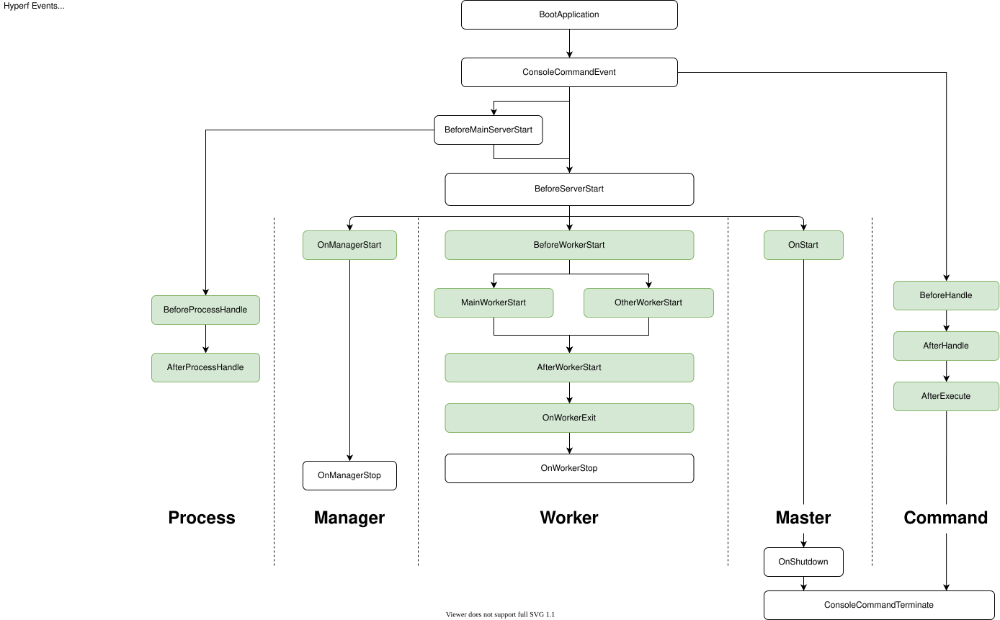

# Mecanismo de eventos

## Prefácio

O padrão de eventos deve ser implementado com base em [PSR-14](https://github.com/php-fig/fig-standards/blob/master/accepted/PSR-14-event-dispatcher.md).   
O gerenciador de eventos do Hyperf é implementado por padrão por [hyperf/event](https://github.com/hyperf/event); esse componente também pode ser usado em outros frameworks ou aplicações, bastando importá-lo via Composer.

```bash
composer require hyperf/event
```

## Conceito

O padrão de eventos é um mecanismo confiável e amplamente testado, muito adequado para desacoplamento. Existem 3 papéis:

- `Evento (Event)` é o objeto de comunicação transmitido entre o código da aplicação e o `Listener`
- `Listener` é o objeto de escuta usado para ouvir a ocorrência do `Evento (Event)`
- `Despachante de eventos (EventDispatcher)` é o objeto gerenciador usado para disparar o `Evento (Event)` e gerenciar a relação entre `Listener` e `Evento (Event)`

Com um exemplo de fácil compreensão: suponha que exista um método `UserService::register()` para registrar uma conta; após o registro bem-sucedido da conta, podemos disparar o evento `UserRegistered` por meio do despachante de eventos, e o listener ouve a ocorrência desse evento e realiza algumas operações no momento do disparo, como enviar o SMS de registro bem-sucedido. Com a evolução do negócio, podemos querer fazer mais coisas após o registro bem-sucedido do usuário, como enviar o e-mail de registro bem-sucedido etc.; nesse caso, basta adicionar mais um listener para ouvir o evento `UserRegistered`, sem adicionar código irrelevante dentro do método `UserService::register()`.

## Usar o gerenciador de eventos

> A seguir apresentaremos o listener por meio de configuração e de anotação; no uso real, basta usar um dos dois. Se houver tanto anotação quanto configuração, o listener será disparado várias vezes.

### Definir um evento

Um evento é, na verdade, uma classe comum usada para gerenciar dados de estado; no disparo, os dados da aplicação são passados para o evento e, em seguida, o listener opera sobre a classe do evento. Um evento pode ser ouvido por vários listeners.

```php
<?php
namespace App\Event;

class UserRegistered
{
    // Sugere-se definir como propriedade public aqui, para que o listener use diretamente essa propriedade, ou forneça um Getter para ela
    public $user;
    
    public function __construct($user)
    {
        $this->user = $user;    
    }
}
```

### Definir um listener

Os listeners precisam implementar os métodos obrigatórios da interface `Hyperf\Event\Contract\ListenerInterface`, conforme o exemplo abaixo.

```php
<?php
namespace App\Listener;

use App\Event\UserRegistered;
use Hyperf\Event\Contract\ListenerInterface;

class UserRegisteredListener implements ListenerInterface
{
    public function listen(): array
    {
        // Retorna um array de eventos que este listener deve ouvir; é possível ouvir vários eventos ao mesmo tempo
        return [
            UserRegistered::class,
        ];
    }

    /**
     * @param UserRegistered $event
     */
    public function process(object $event): void
    {
        // Escreva aqui o código que este listener deve executar após o disparo do evento, como enviar o SMS de registro bem-sucedido neste exemplo
        // Acesse diretamente a propriedade user de $event para obter o valor do parâmetro passado no disparo do evento
        // $event->user;
        
    }
}
```

#### Registrar o listener por arquivo de configuração

Depois de definir o listener, precisamos fazer com que ele seja descoberto pelo `Despachante de eventos (Dispatcher)`. Basta adicionar o listener no arquivo de configuração `config/autoload/listeners.php` *（se não existir, crie-o）*; a ordem de disparo dos listeners segue a ordem de configuração do arquivo:

```php
<?php
return [
    \App\Listener\UserRegisteredListener::class,
];
```

### Registrar o listener por anotação

O Hyperf também oferece uma forma mais simples de registrar o listener: por meio da anotação `#[Listener]`. Basta definir essa anotação na classe do listener e a classe do listener estar dentro do `domínio de escaneamento de anotações do Hyperf` para que o registro seja concluído automaticamente. O código de exemplo é o seguinte:

```php
<?php
namespace App\Listener;

use App\Event\UserRegistered;
use Hyperf\Event\Annotation\Listener;
use Hyperf\Event\Contract\ListenerInterface;

#[Listener]
class UserRegisteredListener implements ListenerInterface
{
    public function listen(): array
    {
        // Retorna um array de eventos que este listener deve ouvir; é possível ouvir vários eventos ao mesmo tempo
        return [
            UserRegistered::class,
        ];
    }

    /**
     * @param UserRegistered $event
     */
    public function process(object $event): void
    {
        // Escreva aqui o código que este listener deve executar após o disparo do evento, como enviar o SMS de registro bem-sucedido neste exemplo
        // Acesse diretamente a propriedade user de $event para obter o valor do parâmetro passado no disparo do evento
        // $event->user;
    }
}
```

Ao registrar o listener por anotação, podemos definir a ordem do listener atual configurando a propriedade `priority`, como `#[Listener(priority=1)]`. A implementação de baixo nível usa a estrutura `SplPriorityQueue` para armazenar; quanto maior o número de `priority`, maior a prioridade.

> Ao usar a anotação `#[Listener]`, é necessário o namespace `use Hyperf\Event\Annotation\Listener;`;  

### Disparar o evento

O evento precisa ser despachado pelo `Despachante de eventos (EventDispatcher)` para que o `Listener` possa ouvi-lo. Vamos demonstrar com um trecho de código como disparar um evento:

```php
<?php
namespace App\Service;

use Hyperf\Di\Annotation\Inject;
use Psr\EventDispatcher\EventDispatcherInterface;
use App\Event\UserRegistered; 

class UserService
{
    #[Inject]
    private EventDispatcherInterface $eventDispatcher;
    
    public function register()
    {
        // Suponhamos que exista a entidade User
        $user = new User();
        $result = $user->save();
        // Conclui a lógica de registro da conta
        // Aqui dispatch(object $event) executará um a um os listeners que ouvem esse evento
        $this->eventDispatcher->dispatch(new UserRegistered($user));
        return $result;
    }
}
```

## Eventos de ciclo de vida do Hyperf



## Eventos de ciclo de vida no estilo corrotina do Hyperf


## Observações

### Não injetar `EventDispatcherInterface` no `Listener`

Porque `EventDispatcherInterface` depende de `ListenerProviderInterface`, e o `ListenerProviderInterface`, ao ser inicializado, coleta todos os `Listener`.

E se o `Listener` também depender de `EventDispatcherInterface`, será causada dependência circular, levando a esgotamento de memória.

### O ideal é injetar apenas `ContainerInterface` no `Listener`.

O ideal é injetar apenas `ContainerInterface` no `Listener`, e obter os outros componentes no `process` por meio do `container`. No início da inicialização do framework, `EventDispatcherInterface` é instanciado; nesse momento ainda não é um ambiente de corrotina. Se o `Listener` injetar classes que possam disparar troca de corrotina, a inicialização do framework poderá falhar.
