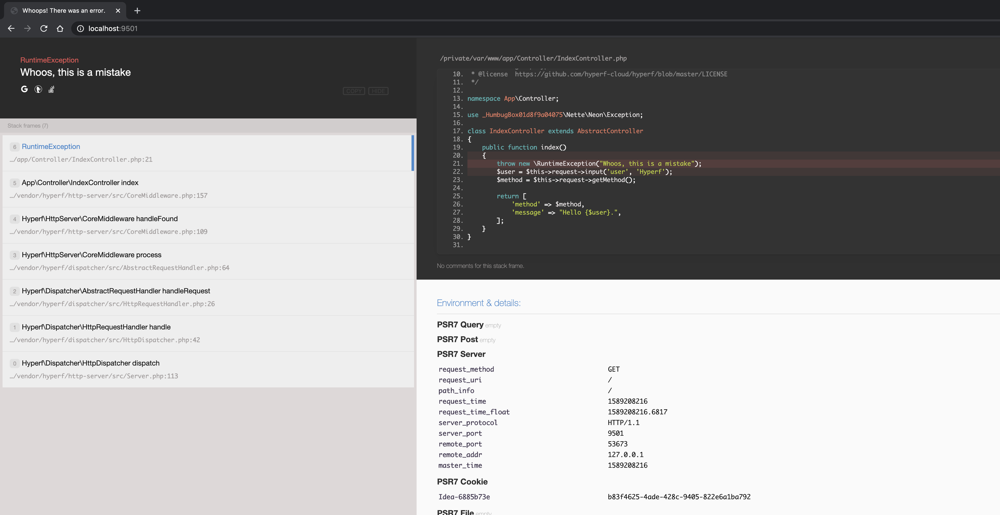

# Manipulador de exceções

No `Hyperf`, todo o código de negócio é executado no `Processo Worker`, o que significa que, se qualquer requisição de negócio tiver uma exceção não capturada, o `Processo Worker` correspondente será interrompido e encerrado, o que também é inaceitável para um serviço. Capturar exceções e enviar um conteúdo de erro razoável ao cliente também é mais amigável.   
Podemos definir diferentes `Manipuladores de exceção (ExceptionHandler)` para cada `server`; uma vez que exista uma exceção não capturada no fluxo de negócio, ela será encaminhada ao `Manipulador de exceção (ExceptionHandler)` já registrado para ser tratada.

## Personalizando um tratamento de exceção

### Registrando o manipulador de exceções por arquivo de configuração

```php
<?php
// config/autoload/exceptions.php
return [
    'handler' => [
        // O http aqui corresponde ao valor name do server dentro de config/autoload/server.php
        'http' => [
            // Aqui é configurado o endereço completo do namespace da classe para concluir o registro deste manipulador de exceções
            \App\Exception\Handler\FooExceptionHandler::class,
        ],    
    ],
];
```

### Registrando o manipulador de exceções por [anotação](https://github.com/hyperf/hyperf/blob/master/src/exception-handler/src/Annotation/ExceptionHandler.php)

```php
<?php
use Hyperf\Contract\StdoutLoggerInterface;
use Hyperf\ExceptionHandler\ExceptionHandler;
use Hyperf\HttpMessage\Stream\SwooleStream;
use Psr\Http\Message\ResponseInterface;
use Throwable;
use Hyperf\ExceptionHandler\Annotation\ExceptionHandler as RegisterHandler;

// O http aqui corresponde ao valor name do server dentro de config/autoload/server.php
// priority é para ordenação
#[RegisterHandler(server: 'http')]
class AppExceptionHandler extends ExceptionHandler
{
    public function __construct(protected StdoutLoggerInterface $logger)
    {
    }

    public function handle(Throwable $throwable, ResponseInterface $response)
    {
        $this->logger->error(sprintf('%s[%s] in %s', $throwable->getMessage(), $throwable->getLine(), $throwable->getFile()));
        $this->logger->error($throwable->getTraceAsString());
        return $response->withHeader('Server', 'Hyperf')->withStatus(500)->withBody(new SwooleStream('Internal Server Error.'));
    }

    public function isValid(Throwable $throwable): bool
    {
        return true;
    }
}

```

> A ordem do array de configuração de cada manipulador de exceções determina a ordem de passagem da exceção entre os manipuladores.

### Definindo o manipulador de exceções

Podemos definir uma `Classe (Class)` em qualquer lugar, herdar da classe abstrata ` Hyperf\ExceptionHandler\ExceptionHandler` e implementar seus métodos abstratos, conforme abaixo:

```php
<?php
namespace App\Exception\Handler;

use Hyperf\ExceptionHandler\ExceptionHandler;
use Hyperf\HttpMessage\Stream\SwooleStream;
use Psr\Http\Message\ResponseInterface;
use App\Exception\FooException;
use Throwable;

class FooExceptionHandler extends  ExceptionHandler
{
    public function handle(Throwable $throwable, ResponseInterface $response)
    {
        // Verifica se a exceção capturada é a exceção que se deseja capturar
        if ($throwable instanceof FooException) {
            // Saída formatada
            $data = json_encode([
                'code' => $throwable->getCode(),
                'message' => $throwable->getMessage(),
            ], JSON_UNESCAPED_UNICODE);

            // Impede a propagação da exceção
            $this->stopPropagation();
            return $response->withStatus(500)->withBody(new SwooleStream($data));
        }

        // Entrega ao próximo manipulador de exceções
        return $response;

        // Ou não faz nada e simplesmente bloqueia a exceção
    }

    /**
     * Determina se este manipulador de exceções deve tratar essa exceção
     */
    public function isValid(Throwable $throwable): bool
    {
        return true;
    }
}
```

### Definindo a classe de exceção

```php
<?php
namespace App\Exception;

use App\Constants\ErrorCode;
use Hyperf\Server\Exception\ServerException;
use Throwable;

class FooException extends ServerException
{
}
```

### Disparando a exceção

```php

namespace App\Controller;

use App\Exception\FooException;

class IndexController extends AbstractController
{
    public function index()
    {
        throw new FooException('Foo Exception...', 800);
    }
}

```
No exemplo acima, primeiro supomos que `FooException` é uma exceção existente e que a configuração desse manipulador já foi concluída. Então, quando o negócio lançar uma exceção não capturada, ela será passada em sequência de acordo com a ordem da configuração. Todo o fluxo de processamento pode ser entendido como um pipeline: se o manipulador de exceções anterior chamar `$this->stopPropagation()`, a exceção não será passada adiante; se o último manipulador de exceções configurado ainda não capturar e tratar a exceção, ela será entregue ao manipulador de exceções padrão do Hyperf.

## Integração com Whoops

O framework fornece integração com o Whoops.

Primeiro instale o Whoops
```php
composer require --dev filp/whoops
```

Depois configure o manipulador de exceções dedicado do Whoops.

```php
// config/autoload/exceptions.php
return [
    'handler' => [
        'http' => [
            \Hyperf\ExceptionHandler\Handler\WhoopsExceptionHandler::class,
        ],    
    ],
];
```

O efeito é mostrado na figura:




## Listener de Error

O framework fornece o listener de nível de erro `error_reporting()` `Hyperf\ExceptionHandler\Listener\ErrorExceptionHandler`.

### Configuração

Adicione o listener em `config/autoload/listeners.php`

```php
<?php
return [
    \Hyperf\ExceptionHandler\Listener\ErrorExceptionHandler::class
];
```

Assim, quando aparecer um código semelhante ao abaixo, será lançada uma exceção `\ErrorException`

```php
<?php
try {
    $a = [];
    var_dump($a[1]);
} catch (\Throwable $throwable) {
    var_dump(get_class($throwable), $throwable->getMessage());
}

// string(14) "ErrorException"
// string(19) "Undefined offset: 1"
```

Se o listener não for configurado, será como abaixo, e nenhuma exceção será lançada.

```
PHP Notice:  Undefined offset: 1 in IndexController.php on line 24

Notice: Undefined offset: 1 in IndexController.php on line 24
NULL
```
