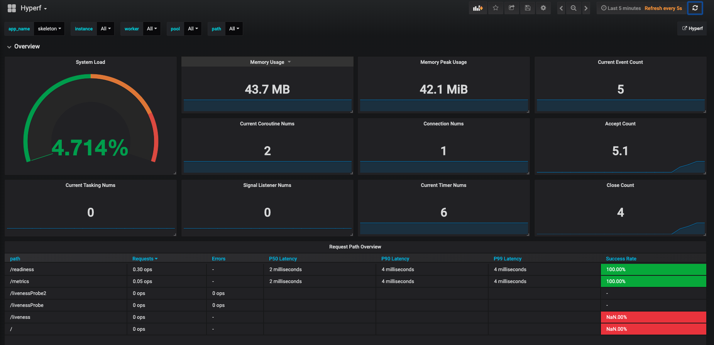

# Monitoramento de serviços

Um requisito central da governança de microsserviços é a observabilidade dos serviços. Como pastor de microsserviços, não é tarefa fácil manter-se a par do estado de saúde de cada serviço a todo momento. Na era cloud-native, muitas soluções surgiram nesse campo. Este componente abstrai a telemetria e o monitoramento, pilares importantes da observabilidade, para facilitar a integração rápida do usuário com a infraestrutura existente e, ao mesmo tempo, evitar o aprisionamento a fornecedores.

## Instalação

### Instalar o componente via Composer

```bash
composer require hyperf/metric
```

O Metric suporta [Prometheus](https://prometheus.io/), [StatsD](https://github.com/statsd/statsd) e [InfluxDB](http://influxdb.com). Você pode executar os comandos abaixo para instalar as dependências correspondentes:

```bash
# Prometheus
composer require promphp/prometheus_client_php
# Dependências necessárias do StatsD
composer require domnikl/statsd
# Dependências necessárias do InfluxDB
composer require influxdb/influxdb-php
```

### Adicionar a configuração do componente

Caso o arquivo não exista, execute o comando abaixo para adicionar o arquivo de configuração `config/autoload/metric.php`:

```bash
php bin/hyperf.php vendor:publish hyperf/metric
```

## Uso

### Configuração

#### Opções

`default`: o valor correspondente a `default` no arquivo de configuração é o nome do driver utilizado. A configuração específica do driver é definida no item `metric`, usando o mesmo driver que `key`.

```php
'default' => env('METRIC_DRIVER', 'prometheus'),
```

* `use_standalone_process`: define se será usado o `processo de monitoramento independente`. Recomenda-se habilitar. Quando desabilitado, a coleta e o envio de métricas serão processados no `processo Worker`.

```php
'use_standalone_process' => env('TELEMETRY_USE_STANDALONE_PROCESS', true),
```

* `enable_default_metric`: define se as métricas padrão serão coletadas. As métricas padrão incluem uso de memória, carga de CPU do sistema, além de métricas do Swoole Server e métricas de corrotina do Swoole.

```php
'enable_default_metric' => env('TELEMETRY_ENABLE_DEFAULT_TELEMETRY', true),
```

`default_metric_interval`: intervalo de envio das métricas padrão, em segundos, o mesmo vale para os itens abaixo.
```php
'default_metric_interval' => env('DEFAULT_METRIC_INTERVAL', 5),
```
#### Configurar o Prometheus

Ao usar o Prometheus, adicione a configuração específica do Prometheus no item `metric` do arquivo de configuração.

```php
use Hyperf\Metric\Adapter\Prometheus\Constants;

return [
    'default' => env('METRIC_DRIVER', 'prometheus'),
    'use_standalone_process' => env('TELEMETRY_USE_STANDALONE_PROCESS', true),
    'enable_default_metric' => env('TELEMETRY_ENABLE_DEFAULT_TELEMETRY', true),
    'default_metric_interval' => env('DEFAULT_METRIC_INTERVAL', 5),
    'metric' => [
        'prometheus' => [
            'driver' => Hyperf\Metric\Adapter\Prometheus\MetricFactory::class,
            'mode' => Constants::SCRAPE_MODE,
            'namespace' => env('APP_NAME', 'skeleton'),
            'scrape_host' => env('PROMETHEUS_SCRAPE_HOST', '0.0.0.0'),
            'scrape_port' => env('PROMETHEUS_SCRAPE_PORT', '9502'),
            'scrape_path' => env('PROMETHEUS_SCRAPE_PATH', '/metrics'),
            'push_host' => env('PROMETHEUS_PUSH_HOST', '0.0.0.0'),
            'push_port' => env('PROMETHEUS_PUSH_PORT', '9091'),
            'push_interval' => env('PROMETHEUS_PUSH_INTERVAL', 5),
        ],
    ],
];
```

O Prometheus possui dois modos de trabalho: o modo scrape (pull) e o modo push (via Prometheus Pushgateway), e este componente suporta ambos.

Ao usar o modo scrape (recomendado oficialmente pelo Prometheus), é necessário definir:

```php
'mode' => Constants::SCRAPE_MODE
```

E configurar o endereço de coleta `scrape_host`, a porta de coleta `scrape_port` e o caminho de coleta `scrape_path`. O Prometheus pode, por meio de acesso HTTP na configuração correspondente, buscar todas as métricas.

> Atenção: no estilo assíncrono, o modo scrape exige a habilitação do processo independente, ou seja, `use_standalone_process = true`.

Ao usar o modo push, é necessário definir:

```php
'mode' => Constants::PUSH_MODE
```

E configurar o endereço de envio `push_host`, a porta de envio `push_port` e o intervalo de envio `push_interval`. Recomenda-se o modo push apenas para tarefas offline.

Devido às diferenças das configurações básicas, pode ser que nenhum dos modos acima atenda à sua necessidade. Este componente também suporta um modo personalizado. No modo personalizado, o componente é responsável apenas pela coleta das métricas, e o envio específico fica a cargo do usuário.

```php
'mode' => Constants::CUSTOM_MODE
```
Por exemplo, você pode querer enviar métricas por meio de uma rota personalizada, ou armazenar as métricas no Redis e deixar que outro serviço independente se encarregue do envio centralizado das métricas, etc. A seção [Envio personalizado](#envio-personalizado) contém os exemplos correspondentes.

#### Configurar o StatsD

Ao usar o StatsD, adicione a configuração específica do StatsD no item `metric` do arquivo de configuração.

```php
return [
    'default' => env('METRIC_DRIVER', 'statd'),
    'use_standalone_process' => env('TELEMETRY_USE_STANDALONE_PROCESS', true),
    'enable_default_metric' => env('TELEMETRY_ENABLE_DEFAULT_TELEMETRY', true),
    'metric' => [
        'statsd' => [
            'driver' => Hyperf\Metric\Adapter\StatsD\MetricFactory::class,
            'namespace' => env('APP_NAME', 'skeleton'),
            'udp_host' => env('STATSD_UDP_HOST', '127.0.0.1'),
            'udp_port' => env('STATSD_UDP_PORT', '8125'),
            'enable_batch' => env('STATSD_ENABLE_BATCH', true),
            'push_interval' => env('STATSD_PUSH_INTERVAL', 5),
            'sample_rate' => env('STATSD_SAMPLE_RATE', 1.0),
        ],
    ],
];
```

Atualmente o StatsD suporta apenas o modo UDP, sendo necessário configurar o endereço UDP `udp_host`, a porta UDP `udp_port`, se o envio é em lote `enable_batch` (reduz o número de requisições), o intervalo de envio em lote `push_interval` e a taxa de amostragem `sample_rate`.

#### Configurar o InfluxDB

Ao usar o InfluxDB, adicione a configuração específica do InfluxDB no item `metric` do arquivo de configuração.

```php
return [
    'default' => env('METRIC_DRIVER', 'influxdb'),
    'use_standalone_process' => env('TELEMETRY_USE_STANDALONE_PROCESS', true),
    'enable_default_metric' => env('TELEMETRY_ENABLE_DEFAULT_TELEMETRY', true),
    'metric' => [
        'influxdb' => [
            'driver' => Hyperf\Metric\Adapter\InfluxDB\MetricFactory::class,
            'namespace' => env('APP_NAME', 'skeleton'),
            'host' => env('INFLUXDB_HOST', '127.0.0.1'),
            'port' => env('INFLUXDB_PORT', '8086'),
            'username' => env('INFLUXDB_USERNAME', ''),
            'password' => env('INFLUXDB_PASSWORD', ''),
            'dbname' => env('INFLUXDB_DBNAME', true),
            'push_interval' => env('INFLUXDB_PUSH_INTERVAL', 5),
        ],
    ],
];
```

O InfluxDB usa o modo HTTP padrão, sendo necessário configurar o endereço `host`, a porta `port`, o nome de usuário `username`, a senha `password`, `dbname` (tabela de dados) e o intervalo de envio em lote `push_interval`.

### Abstração básica

O componente de telemetria abstrai os três tipos de dados mais comuns, a fim de garantir o desacoplamento da implementação concreta.

Os três tipos são:

Contador (Counter): usado para descrever um tipo de métrica que cresce em apenas uma direção. Como a contagem de requisições HTTP.

```php
interface CounterInterface
{
    public function with(string ...$labelValues): self;

    public function add(int $delta);
}
```

Medidor (Gauge): usado para descrever um tipo de métrica que aumenta ou diminui ao longo do tempo. Como o número de conexões disponíveis no pool de conexões.

```php
interface GaugeInterface
{
    public function with(string ...$labelValues): self;

    public function set(float $value);

    public function add(float $delta);
}
```

* Histograma (Histogram): usado para descrever a distribuição estatística gerada pela observação contínua de um evento, geralmente representada por percentis ou buckets. Como a latência de requisições HTTP.

```php
interface HistogramInterface
{
    public function with(string ...$labelValues): self;

    public function put(float $sample);
}
```

### Configurar o middleware

Depois de configurar o driver, basta configurar um middleware para habilitar a estatística de Histograma das requisições.
Abra o arquivo `config/autoload/middlewares.php`; o exemplo habilita o middleware no Server `http`.

```php
<?php

declare(strict_types=1);

return [
    'http' => [
        \Hyperf\Metric\Middleware\MetricMiddleware::class,
    ],
];
```
> As dimensões estatísticas deste middleware incluem `request_status`, `request_path` e `request_method`. Se houver muitos valores de `request_path`, recomenda-se reescrever este middleware removendo a dimensão `request_path`, caso contrário, uma cardinalidade muito alta causará estouro de memória.

### Uso personalizado

A telemetria por meio do middleware HTTP é apenas a ponta do iceberg dos usos deste componente. Você pode injetar a classe `Hyperf\Metric\Contract\MetricFactoryInterface` para realizar a telemetria dos dados do seu próprio negócio. Por exemplo: quantidade de pedidos criados, quantidade de cliques em anúncios, etc.

```php
<?php

declare(strict_types=1);

namespace App\Controller;

use App\Model\Order;
use Hyperf\Di\Annotation\Inject;
use Hyperf\Metric\Contract\MetricFactoryInterface;

class IndexController extends AbstractController
{
    #[Inject]
    private MetricFactoryInterface $metricFactory;

    public function create(Order $order)
    {
        $counter = $this->metricFactory->makeCounter('order_created', ['order_type']);
        $counter->with($order->type)->add(1);
        // Lógica do pedido...
    }

}
```

`MetricFactoryInterface` contém os seguintes métodos de fábrica para gerar os três tipos básicos de estatística correspondentes.

```php
public function makeCounter($name, $labelNames): CounterInterface;

public function makeGauge($name, $labelNames): GaugeInterface;

public function makeHistogram($name, $labelNames): HistogramInterface;
```

O exemplo acima contabiliza as métricas geradas no escopo da requisição. Às vezes precisamos contabilizar métricas voltadas para todo o ciclo de vida, como o comprimento de uma fila assíncrona ou a quantidade de produtos em estoque. Nesse cenário, podemos escutar o evento `MetricFactoryReady`.

```php
<?php

declare(strict_types=1);

namespace App\Listener;

use Hyperf\Event\Contract\ListenerInterface;
use Hyperf\Metric\Event\MetricFactoryReady;
use Psr\Container\ContainerInterface;
use Redis;

class OnMetricFactoryReady implements ListenerInterface
{
    protected ContainerInterface $container;

    public function __construct(ContainerInterface $container)
    {
        $this->container = $container;
    }

    public function listen(): array
    {
        return [
            MetricFactoryReady::class,
        ];
    }

    public function process(object $event)
    {
        $redis = $this->container->get(Redis::class);
        $gauge = $event
                    ->factory
                    ->makeGauge('queue_length', ['driver'])
                    ->with('redis');
        while (true) {
            $length = $redis->llen('queue');
            $gauge->set($length);
            sleep(1);
        }
    }
}
```

> Do ponto de vista de engenharia, consultar diretamente o comprimento da fila no Redis não é muito adequado; o correto seria obter o comprimento da fila por meio do método `info()` da interface `DriverInterface` do driver de fila. Aqui fazemos apenas uma demonstração simples. Você pode encontrar exemplos completos na pasta `src/Listener` do código-fonte deste componente.

### Anotação

Você pode usar `#[Counter(name="stat_name_here")]` e `#[Histogram(name="stat_name_here")]` para contabilizar o número de chamadas e o tempo de execução de um aspecto.

Sobre o uso de anotações, consulte o [capítulo de anotações](annotation.md).

### Personalizar Histogram Bucket

> Esta seção se aplica apenas ao driver Prometheus

Quando você usa o Histogram do Prometheus, às vezes há a necessidade de personalizar os Buckets. Você pode, antes de iniciar o serviço, injetar o Registry por injeção de dependência e registrar o Histogram manualmente, definindo os Buckets necessários. Posteriormente, ao usar, o `MetricFactory` chamará o Histogram de mesmo nome que você registrou. Exemplo abaixo:

```php
<?php

namespace App\Listener;

use Hyperf\Config\Annotation\Value;
use Hyperf\Event\Contract\ListenerInterface;
use Hyperf\Framework\Event\BeforeMainServerStart;
use Prometheus\CollectorRegistry;

class OnMainServerStart implements ListenerInterface
{
    protected $registry;

    public function __construct(CollectorRegistry $registry)
    {
        $this->registry = $registry;
    }

    public function listen(): array
    {
        return [
            BeforeMainServerStart::class,
        ];
    }

    public function process(object $event)
    {
        $this->registry->registerHistogram(
            config("metric.metric.prometheus.namespace"), 
            'test',
            'help_message', 
            ['labelName'], 
            [0.1, 1, 2, 3.5]
        );
    }
}
```
Depois disso, ao usar `$metricFactory->makeHistogram('test')`, retornará o Histogram que você registrou previamente.

### Envio personalizado

> Esta seção se aplica apenas ao driver Prometheus

Após definir o modo de trabalho do driver Prometheus do componente como modo personalizado (`Constants::CUSTOM_MODE`), você pode lidar livremente com o envio das métricas. Nesta seção, mostramos como armazenar as métricas no Redis e, em seguida, adicionar uma nova rota HTTP no Worker, retornando as métricas renderizadas pelo Prometheus.

#### Usar o Redis para armazenar as métricas

O meio de armazenamento das métricas é definido pela interface `Prometheus\Storage\Adapter`. O padrão é o armazenamento em memória. Podemos trocá-lo pelo armazenamento em Redis em `config/autoload/dependencies.php`.

```php
<?php

return [
    Prometheus\Storage\Adapter::class => Hyperf\Metric\Adapter\Prometheus\RedisStorageFactory::class,
];
```

#### Adicionar a rota /metrics no Worker

Adicione a rota do Prometheus em config/routes.php.

> Atenção: para obter as métricas no Worker, você precisa lidar você mesmo com o compartilhamento de estado entre os Workers. Uma das formas é armazenar o estado no Redis conforme descrito acima.

```php
<?php

use Hyperf\HttpServer\Router\Router;

Router::get('/metrics', function(){
    $registry = Hyperf\Context\ApplicationContext::getContainer()->get(Prometheus\CollectorRegistry::class);
    $renderer = new Prometheus\RenderTextFormat();
    return $renderer->render($registry->getMetricFamilySamples());
});
```

## Criar um painel no Grafana

> Esta seção se aplica apenas ao driver Prometheus

Se você habilitou as métricas padrão, o `Hyperf/Metric` preparou um painel do Grafana pronto para uso. Baixe o [arquivo json](https://cdn.jsdelivr.net/gh/hyperf/hyperf/src/metric/grafana.json) do painel e importe-o no Grafana para utilizá-lo.



## Observações

- Para usar este componente para coletar métricas em comandos personalizados do `hyperf/command`, é necessário adicionar o parâmetro de linha de comando ao iniciar o comando: `--enable-event-dispatcher`.
