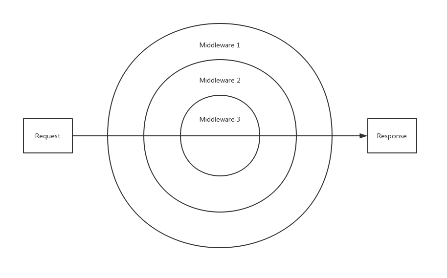

# Middleware

O middleware aqui se refere ao "padrão de middleware", um recurso principal do componente [hyperf/http-server](https://github.com/hyperf/http-server), utilizado principalmente para tecer todo o fluxo de `requisição (Request)` até `resposta (Response)`, implementado totalmente com base no [PSR-15](https://www.php-fig.org/psr/psr-15/).

## Princípio

*O middleware é usado principalmente para tecer todo o fluxo de `requisição (Request)` até `resposta (Response)`*; ao organizar vários middlewares, o fluxo dos dados segue a forma que determinamos. O middleware é essencialmente um `modelo de cebola`; vamos explicá-lo com uma figura:



A ordem na figura é organizada como `Middleware 1 -> Middleware 2 -> Middleware 3`. Podemos notar que, quando a linha horizontal do meio atravessa o `núcleo`, ou seja, o `Middleware 3`, ela retorna ao `Middleware 2`, formando um modelo aninhado. Logo, a ordem real é:   
`Request -> Middleware 1 -> Middleware 2 -> Middleware 3 -> Middleware 2 -> Middleware 1 -> Response`   
O foco está no `núcleo`, ou seja, no `Middleware 3`, que é o ponto de divisão da cebola. A parte antes do ponto de divisão é processada com base na `requisição (Request)`; ao passar pelo ponto de divisão, o `núcleo` produz o objeto `resposta (Response)`, que também é o principal objetivo do código do `núcleo`; depois disso, é a vez de processar a `resposta (Response)`. O `núcleo` normalmente é implementado pelo framework, e o restante é organizado por você.

## Definir middleware global

O middleware global só pode ser configurado por meio de arquivo de configuração, localizado em `config/autoload/middlewares.php`, com a seguinte configuração:   
```php
<?php
return [
    // http corresponde ao valor da propriedade name de cada server em config/autoload/server.php; esta configuração é aplicada apenas a esse Server
    'http' => [
        // Configure seus middlewares globais no array; a ordem segue a ordem do array
        YourMiddleware::class
    ],
];
```
Basta configurar seu middleware global nesse arquivo e no `Server Name` correspondente para que todos os requests sob esse `Server` apliquem os middlewares globais configurados.

## Definir middleware local

Quando alguns middlewares se destinam apenas a determinados requests ou controladores, podemos defini-los como middlewares locais, por meio de arquivo de configuração ou de anotação.

### Definir por arquivo de configuração

Ao definir rotas por arquivo de configuração, você só pode definir o middleware correspondente por arquivo de configuração; a configuração do middleware local será feita na configuração da rota.   
O último parâmetro `$options` de cada método de definição de rota da classe `Hyperf\HttpServer\Router\Router` receberá um array; é possível definir o middleware da rota passando a chave `middleware` com um valor de array. Vamos demonstrar com algumas definições de rota:

```php
<?php
use App\Middleware\FooMiddleware;
use Hyperf\HttpServer\Router\Router;

// Cada método de definição de rota pode receber um parâmetro $options
Router::get('/', [\App\Controller\IndexController::class, 'index'], ['middleware' => [FooMiddleware::class]]);
Router::post('/', [\App\Controller\IndexController::class, 'index'], ['middleware' => [FooMiddleware::class]]);
Router::put('/', [\App\Controller\IndexController::class, 'index'], ['middleware' => [FooMiddleware::class]]);
Router::patch('/', [\App\Controller\IndexController::class, 'index'], ['middleware' => [FooMiddleware::class]]);
Router::delete('/', [\App\Controller\IndexController::class, 'index'], ['middleware' => [FooMiddleware::class]]);
Router::head('/', [\App\Controller\IndexController::class, 'index'], ['middleware' => [FooMiddleware::class]]);
Router::addRoute(['GET', 'POST', 'HEAD'], '/index', [\App\Controller\IndexController::class, 'index'], ['middleware' => [FooMiddleware::class]]);

// Todas as rotas sob este Group aplicarão os middlewares configurados
Router::addGroup(
    '/v2', function () {
        Router::get('/index', [\App\Controller\IndexController::class, 'index']);
    },
    ['middleware' => [FooMiddleware::class]]
);

```

### Definir por anotação

Ao definir rotas por anotação, você só pode definir o middleware por anotação. Há duas anotações para definir middleware, respectivamente:   
  - A anotação `#[Middleware]` é usada para definir um único middleware; em um mesmo local só pode ser definida uma vez, não podendo ser repetida
  - A anotação `#[Middlewares]` é usada para definir múltiplos middlewares; em um mesmo local só pode ser definida uma vez, e então, dentro dessa anotação, define-se múltiplas anotações `#[Middleware]` para implementar a definição de múltiplos middlewares

> Para usar a anotação `#[Middleware]`, é necessário o namespace `use Hyperf\HttpServer\Annotation\Middleware;`;   
> Para usar a anotação `#[Middlewares]`, é necessário o namespace `use Hyperf\HttpServer\Annotation\Middlewares;`;

***Atenção: é obrigatório usar em conjunto com `#[AutoController]` ou `#[Controller]`***

Definir um único middleware:

```php
<?php
namespace App\Controller;

use App\Middleware\FooMiddleware;
use Hyperf\HttpServer\Annotation\AutoController;
use Hyperf\HttpServer\Annotation\Middleware;

#[AutoController]
#[Middleware(FooMiddleware::class)]
class IndexController
{
    public function index()
    {
        return 'Hello Hyperf.';
    }
}
```

Definir múltiplos middlewares por meio da anotação `#[Middlewares]`:

```php
<?php
namespace App\Controller;

use App\Middleware\BarMiddleware;
use App\Middleware\FooMiddleware;
use Hyperf\HttpServer\Annotation\AutoController;
use Hyperf\HttpServer\Annotation\Middleware;
use Hyperf\HttpServer\Annotation\Middlewares;

#[AutoController]
#[Middlewares([FooMiddleware::class, BarMiddleware::class])]
class IndexController
{
    public function index()
    {
        return 'Hello Hyperf.';
    }
}
```

Definir múltiplos middlewares por meio da anotação `#[Middleware]`:

```php
<?php
namespace App\Controller;

use App\Middleware\BarMiddleware;
use App\Middleware\FooMiddleware;
use Hyperf\HttpServer\Annotation\AutoController;
use Hyperf\HttpServer\Annotation\Middleware;
use Hyperf\HttpServer\Annotation\Middlewares;

#[AutoController]
#[Middleware(FooMiddleware::class)]
#[Middleware(BarMiddleware::class)]
class IndexController
{
    public function index()
    {
        return 'Hello Hyperf.';
    }
}
```

#### Definir middleware no nível de método

Ao configurar middlewares por arquivo de configuração, defini-los no nível de método é muito simples; e para defini-los no nível de método por anotação? Basta definir a anotação diretamente no método.   
O middleware no nível de classe tem prioridade sobre o middleware no nível de método; vamos exemplificar com código:   

```php
<?php
namespace App\Controller;

use App\Middleware\BarMiddleware;
use App\Middleware\FooMiddleware;
use Hyperf\HttpServer\Annotation\AutoController;
use Hyperf\HttpServer\Annotation\Middleware;
use Hyperf\HttpServer\Annotation\Middlewares;

#[AutoController]
#[Middlewares([FooMiddleware::class])]
class IndexController
{
    #[Middleware(BarMiddleware::class)]
    public function index()
    {
        return 'Hello Hyperf.';
    }
}
```

#### Código relacionado a middleware

Gerar middleware

```
php ./bin/hyperf.php gen:middleware Auth/FooMiddleware
```

```php
<?php

declare(strict_types=1);

namespace App\Middleware\Auth;

use Hyperf\HttpServer\Contract\RequestInterface;
use Hyperf\HttpServer\Contract\ResponseInterface as HttpResponse;
use Psr\Container\ContainerInterface;
use Psr\Http\Message\ResponseInterface;
use Psr\Http\Message\ServerRequestInterface;
use Psr\Http\Server\MiddlewareInterface;
use Psr\Http\Server\RequestHandlerInterface;

class FooMiddleware implements MiddlewareInterface
{
    protected ContainerInterface $container;

    protected RequestInterface $request;

    protected HttpResponse $response;

    public function __construct(ContainerInterface $container, HttpResponse $response, RequestInterface $request)
    {
        $this->container = $container;
        $this->response = $response;
        $this->request = $request;
    }

    public function process(ServerRequestInterface $request, RequestHandlerInterface $handler): ResponseInterface
    {
        // Determina o rumo da lógica conforme o negócio concreto; aqui supomos que o token trazido pelo usuário é válido
        $isValidToken = true;
        if ($isValidToken) {
            return $handler->handle($request);
        }

        return $this->response->json(
            [
                'code' => -1,
                'data' => [
                    'error' => 'A validação de token do middleware é inválida; impedindo a continuação da execução',
                ],
            ]
        );
    }
}
```
A ordem de execução dos middlewares é `FooMiddleware -> BarMiddleware`.

## Ordem de execução dos middlewares

Como vimos acima, existem `3` níveis de middleware: `middleware global`, `middleware de nível de classe` e `middleware de nível de método`. Se todos forem definidos, a ordem de execução é: `middleware global -> middleware de nível de classe -> middleware de nível de método`.


Nas versões `>=3.0.34`, foi adicionada a configuração de prioridade, que permite alterar a ordem de execução dos middlewares ao configurar métodos e middlewares de rota. Quanto maior a prioridade, mais cedo a execução.

```php
// Arquivo de configuração de middleware global middleware.php
return [
    'http' => [
        YourMiddleware::class,
        YourMiddlewareB::class => 3,
    ],
];
```
```php
// Configuração de middleware de rota
Router::addGroup(
    '/v2', function () {
        Router::get('/index', [\App\Controller\IndexController::class, 'index']);
    },
    [
        'middleware' => [
            FooMiddleware::class,
            FooMiddlewareB::class => 3,
        ]
    ]
);
```
```php
// Configuração de middleware por anotação
#[AutoController]
#[Middleware(FooMiddleware::class)]
#[Middleware(FooMiddlewareB::class, 3)]
#[Middlewares([FooMiddlewareC::class => 1, BarMiddlewareD::class => 4])]
class IndexController
{
    
}
```

## Alterar globalmente os objetos de requisição e resposta

Primeiramente, no contexto da corrotina há o armazenamento dos objetos PSR-7 `de requisição` e `de resposta` originais. Além disso, conforme a `imutabilidade (immutable)` exigida pelo PSR-7 para os objetos relacionados, o `$response` obtido ao chamar `$response = $response->with***()` não é uma modificação do objeto original, mas sim um novo objeto `Clone`, o que significa que os objetos `de requisição` e `de resposta` armazenados no contexto da corrotina não serão alterados. Assim, quando alguma lógica dentro do middleware alterar o `objeto de requisição` ou o `objeto de resposta`, e quisermos que o código *não transmissivo* posterior obtenha o `objeto de requisição` ou `objeto de resposta` alterado, podemos, após alterar o objeto, definir o novo objeto no contexto, conforme o código abaixo:

```php
use Psr\Http\Message\ResponseInterface;
use Psr\Http\Message\ServerRequestInterface;

// $request e $response são os objetos modificados
$request = \Hyperf\Context\Context::set(ServerRequestInterface::class, $request);
$response = \Hyperf\Context\Context::set(ResponseInterface::class, $response);
```

## Personalizar o comportamento do CoreMiddleWare

Por padrão, quando o Hyperf lida com uma rota não encontrada ou um método HTTP não permitido, ou seja, quando o código de status HTTP é `404` ou `405`, é o `CoreMiddleware` que processa diretamente e retorna o objeto de resposta correspondente. Graças ao design de injeção de dependência do Hyperf, você pode apontar o `CoreMiddleware` para um `CoreMiddleware` implementado por você mesmo, substituindo o objeto.

Por exemplo, se quisermos definir uma classe `App\Middleware\CoreMiddleware` para sobrescrever o comportamento padrão, podemos primeiro definir a classe `App\Middleware\CoreMiddleware` como abaixo. Aqui usamos apenas o HTTP Server como exemplo; outros Servers também podem adotar a mesma abordagem para atingir o mesmo objetivo.

```php
<?php
declare(strict_types=1);

namespace App\Middleware;

use Hyperf\Contract\Arrayable;
use Hyperf\HttpMessage\Stream\SwooleStream;
use Psr\Http\Message\ResponseInterface;
use Psr\Http\Message\ServerRequestInterface;

class CoreMiddleware extends \Hyperf\HttpServer\CoreMiddleware
{
    /**
     * Handle the response when cannot found any routes.
     *
     * @return array|Arrayable|mixed|ResponseInterface|string
     */
    protected function handleNotFound(ServerRequestInterface $request)
    {
        // Sobrescreve a lógica de tratamento de rota não encontrada
        return $this->response()->withStatus(404);
    }

    /**
     * Handle the response when the routes found but doesn't match any available methods.
     *
     * @return array|Arrayable|mixed|ResponseInterface|string
     */
    protected function handleMethodNotAllowed(array $methods, ServerRequestInterface $request)
    {
        // Sobrescreve a lógica de tratamento de método HTTP não permitido
        return $this->response()->withStatus(405);
    }
}
```

Em seguida, defina a relação de objetos em `config/autoload/dependencies.php` para sobrescrever o objeto CoreMiddleware:

```php
<?php
return [
    Hyperf\HttpServer\CoreMiddleware::class => App\Middleware\CoreMiddleware::class,
];
```

> A abordagem de sobrescrever diretamente o CoreMiddleware aqui só é válida na versão 1.1.0+; na versão 1.0.x ainda é necessário sobrescrever por meio de DI a chamada de nível superior do CoreMiddleware e, depois, substituir o valor passado ao CoreMiddleware pela classe de middleware definida por você.

## Middlewares comuns

### Middleware de CORS

Se você precisar resolver CORS no framework, pode implementar o seguinte middleware conforme sua necessidade

```php
<?php

declare(strict_types=1);

namespace App\Middleware;

use Hyperf\Context\Context;
use Psr\Http\Message\ResponseInterface;
use Psr\Http\Message\ServerRequestInterface;
use Psr\Http\Server\MiddlewareInterface;
use Psr\Http\Server\RequestHandlerInterface;

class CorsMiddleware implements MiddlewareInterface
{
    public function process(ServerRequestInterface $request, RequestHandlerInterface $handler): ResponseInterface
    {
        $response = Context::get(ResponseInterface::class);
        $response = $response->withHeader('Access-Control-Allow-Origin', '*')
            ->withHeader('Access-Control-Allow-Credentials', 'true')
            // Os Headers podem ser reescritos conforme a situação real.
            ->withHeader('Access-Control-Allow-Headers', 'DNT,Keep-Alive,User-Agent,Cache-Control,Content-Type,Authorization');

        Context::set(ResponseInterface::class, $response);

        if ($request->getMethod() == 'OPTIONS') {
            return $response;
        }

        return $handler->handle($request);
    }
}

```

Na verdade, a configuração de CORS também pode ser colocada diretamente no `Nginx`.

```
location / {
    add_header Access-Control-Allow-Origin *;
    add_header Access-Control-Allow-Methods 'GET, POST, OPTIONS';
    add_header Access-Control-Allow-Headers 'DNT,Keep-Alive,User-Agent,Cache-Control,Content-Type,Authorization';

    if ($request_method = 'OPTIONS') {
        return 204;
    }
}
```

### Middleware pós-processamento

Normalmente, executamos por último

```
return $handler->handle($request);
```

Portanto, equivale a um middleware de pré-processamento. Se quiser que a lógica do middleware seja executada depois, basta trocar a ordem de execução.

```php
<?php

declare(strict_types=1);

namespace App\Middleware;

use Hyperf\HttpServer\Contract\RequestInterface;
use Psr\Container\ContainerInterface;
use Psr\Http\Message\ResponseInterface;
use Psr\Http\Message\ServerRequestInterface;
use Psr\Http\Server\MiddlewareInterface;
use Psr\Http\Server\RequestHandlerInterface;

class OpenApiMiddleware implements MiddlewareInterface
{
    public function __construct(protected ContainerInterface $container)
    {
    }

    public function process(ServerRequestInterface $request, RequestHandlerInterface $handler): ResponseInterface
    {
        // TODO: operação de pré-processamento
        try{
            $result = $handler->handle($request);
        } finally {
            // TODO: operação de pós-processamento
        }
        return $result;
    }
}

```
