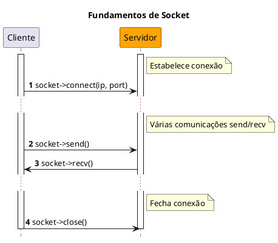
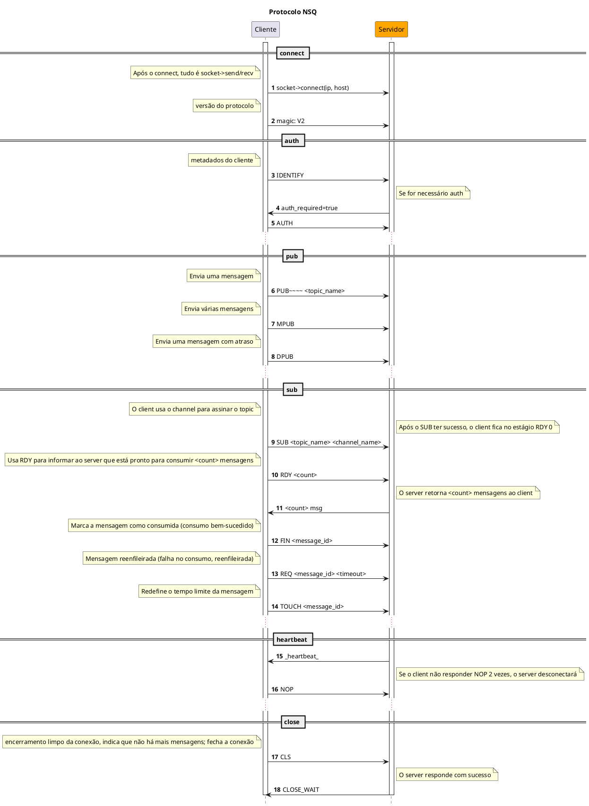

# NSQ

[NSQ](https://nsq.io) é um middleware de mensagens distribuído em tempo real, open source, leve e de alto desempenho, escrito na linguagem Go.

## Instalação

```bash
composer require hyperf/nsq
```

## Uso

### Configuração

O arquivo de configuração do componente NSQ fica por padrão em `config/autoload/nsq.php`; caso esse arquivo não exista, você pode usar o comando `php bin/hyperf.php vendor:publish hyperf/nsq` para publicar o arquivo de configuração correspondente.

O arquivo de configuração padrão é o seguinte:

```php
<?php
return [
    'default' => [
        'host' => '127.0.0.1',
        'port' => 4150,
        'pool' => [
            'min_connections' => 1,
            'max_connections' => 10,
            'connect_timeout' => 10.0,
            'wait_timeout' => 3.0,
            'heartbeat' => -1,
            // Como o tempo ocioso padrão do serviço Nsq é 60s, o tempo ocioso máximo mantido pelo framework deve ser menor que 60s
            'max_idle_time' => 30.0,
        ],
    ],
];
```

### Criar consumidor

Por meio do comando `gen:nsq-consumer`, é possível gerar rapidamente um consumidor (Consumer) para consumir mensagens.

```bash
php bin/hyperf.php gen:nsq-consumer DemoConsumer
```

Você também pode usar a anotação `Hyperf\Nsq\Annotation\Consumer` para declarar uma subclasse da classe abstrata `Hyperf/Nsq/AbstractConsumer`, concluindo a definição de um consumidor (Consumer). Tanto a anotação `Hyperf\Nsq\Annotation\Consumer` quanto a classe abstrata contêm as seguintes propriedades:
 
|   Configuração  |  Tipo  |  Valor padrão da anotação ou da classe abstrata |       Observação       |
|:-------:|:------:|:------:|:----------------:|
|  topic  | string |   ''   |  topic a ser escutado   |
| channel | string |   ''   |  channel a ser escutado |
|   name  | string | NsqConsumer |  Nome do consumidor     |
|   nums  |  int   |   1    |  Número de processos do consumidor   |
|   pool  | string |   default   |  Conexão correspondente ao consumidor, corresponde à key do arquivo de configuração |

Essas propriedades da anotação são opcionais, pois a classe abstrata `Hyperf/Nsq/AbstractConsumer` também define as propriedades de membro correspondentes, bem como getter e setter; quando as propriedades da anotação não são definidas, são usados os valores padrão das propriedades da classe abstrata.

```php
<?php

declare(strict_types=1);

namespace App\Nsq\Consumer;

use Hyperf\Nsq\AbstractConsumer;
use Hyperf\Nsq\Annotation\Consumer;
use Hyperf\Nsq\Message;
use Hyperf\Nsq\Result;

#[Consumer(topic: "hyperf", channel: "hyperf", name: "DemoNsqConsumer", nums: 1)]
class DemoNsqConsumer extends AbstractConsumer
{
    public function consume(Message $payload): string 
    {
        var_dump($payload->getBody());

        return Result::ACK;
    }
}
```

### Impedir a inicialização automática do processo de consumo

Por padrão, após a definição com a anotação `#[Consumer]`, o framework cria automaticamente um subprocesso na inicialização para iniciar o consumidor e, caso o subprocesso saia de forma anormal, o reinicia automaticamente. No entanto, durante a fase de desenvolvimento, ao realizar certos trabalhos de depuração, o consumo automático do consumidor pode causar inconvenientes na depuração.

Nesse caso, você pode controlar a inicialização automática do processo de consumo de duas formas: desativação global e desativação local.

#### Desativação global

Você pode definir a opção `enable` da conexão correspondente como `false` no arquivo de configuração padrão `config/autoload/nsq.php`, o que significa que todos os processos de consumidores dessa conexão terão a inicialização automática desativada.

#### Desativação local

Quando você precisar desativar a inicialização automática apenas de processos de consumo individuais, basta sobrescrever o método `isEnable()` da classe pai no consumidor correspondente e retornar `false` para desativar a inicialização automática desse consumidor;

```php
<?php

declare(strict_types=1);

namespace App\Nsq\Consumer;

use Hyperf\Nsq\AbstractConsumer;
use Hyperf\Nsq\Annotation\Consumer;
use Hyperf\Nsq\Message;
use Hyperf\Nsq\Result;
use Psr\Container\ContainerInterface;

#[Consumer(topic: "demo_topic", channel: "demo_channel", name: "DemoConsumer", nums: 1)]
class DemoConsumer extends AbstractConsumer
{
    public function __construct(ContainerInterface $container)
    {
        parent::__construct($container);
    }

    public function isEnable(): bool 
    {
        return false;
    }

    public function consume(Message $payload): string
    {
        $body = json_decode($payload->getBody(), true);
        var_dump($body);
        return Result::ACK;
    }
}
```

### Publicar mensagens

Você pode publicar mensagens no NSQ chamando o método `Hyperf\Nsq\Nsq::publish(string $topic, $message, float $deferTime = 0.0)`. Abaixo, um exemplo de publicação de mensagens em um Command:

```php
<?php

declare(strict_types=1);

namespace App\Command;

use Hyperf\Command\Command as HyperfCommand;
use Hyperf\Command\Annotation\Command;
use Hyperf\Nsq\Nsq;

#[Command]
class NsqCommand extends HyperfCommand
{
    protected $name = 'nsq:pub';

    public function handle()
    {
        /** @var Nsq $nsq */
        $nsq = make(Nsq::class);
        $topic = 'hyperf';
        $message = 'This is message at ' . time();
        $nsq->publish($topic, $message);

        $this->line('success', 'info');
    }
}
```

### Publicar várias mensagens de uma só vez

Além de poder receber uma string, o segundo parâmetro do método `Hyperf\Nsq\Nsq::publish(string $topic, $message, float $deferTime = 0.0)` também pode receber um array de strings, para publicar várias mensagens de uma só vez em um Topic. Exemplo abaixo:

```php
<?php

declare(strict_types=1);

namespace App\Command;

use Hyperf\Command\Command as HyperfCommand;
use Hyperf\Command\Annotation\Command;
use Hyperf\Nsq\Nsq;

#[Command]
class NsqCommand extends HyperfCommand
{
    protected $name = 'nsq:pub';

    public function handle()
    {
        /** @var Nsq $nsq */
        $nsq = make(Nsq::class);
        $topic = 'hyperf';
        $messages = [
            'This is message 1 at ' . time(),
            'This is message 2 at ' . time(),
            'This is message 3 at ' . time(),
        ];
        $nsq->publish($topic, $messages);

        $this->line('success', 'info');
    }
}
```

### Publicar mensagens com atraso

Quando você deseja que a mensagem publicada seja consumida após um tempo específico, também pode passar o tempo de atraso correspondente no terceiro parâmetro do método `Hyperf\Nsq\Nsq::publish(string $topic, $message, float $deferTime = 0.0)`, em segundos. Exemplo abaixo:

```php
<?php

declare(strict_types=1);

namespace App\Command;

use Hyperf\Command\Command as HyperfCommand;
use Hyperf\Command\Annotation\Command;
use Hyperf\Nsq\Nsq;

#[Command]
class NsqCommand extends HyperfCommand
{
    protected $name = 'nsq:pub';

    public function handle()
    {
        /** @var Nsq $nsq */
        $nsq = make(Nsq::class);
        $topic = 'hyperf';
        $message = 'This is message at ' . time();
        $deferTime = 5.0;
        $nsq->publish($topic, $message, $deferTime);

        $this->line('success', 'info');
    }
}
```

### NSQD HTTP API

> Referência da NSQD HTTP API: https://nsq.io/components/nsqd.html

O componente encapsula a NSQD HTTP API, permitindo que você chame a NSQD HTTP API de forma muito conveniente. 

Por exemplo, quando precisar excluir um determinado `Topic`, você pode executar o seguinte código:

```php
<?php
use Hyperf\Context\ApplicationContext;
use Hyperf\Nsq\Nsqd\Topic;

$container = ApplicationContext::getContainer();

$client = $container->get(Topic::class);

$client->delete('hyperf.test');
```

- A classe `Hyperf\Nsq\Api\Topic` corresponde às APIs relacionadas a `topic`;
- A classe `Hyperf\Nsq\Api\Channle` corresponde às APIs relacionadas a `channel`;
- A classe `Hyperf\Nsq\Api\Api` corresponde às APIs relacionadas a `ping`, `stats`, `config`, `debug` etc.;

## Protocolo NSQ

> https://nsq.io/clients/tcp_protocol_spec.html

- Fundamentos de Socket



- Fluxo do protocolo NSQ


