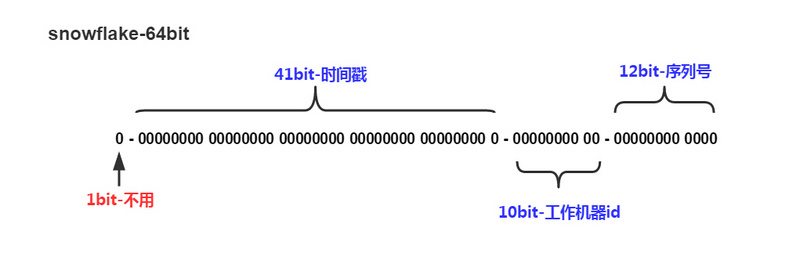

# Snowflake

## Introdução ao algoritmo

`Snowflake` é um algoritmo distribuído de geração de ID globalmente único proposto pelo Twitter. O resultado da geração de `ID` pelo algoritmo é um inteiro longo de `64 bits`. No algoritmo padrão, sua estrutura é mostrada na figura abaixo:



- `1 bit`, não utilizado.
  - O bit mais alto no binário é o bit de sinal; os `ID` que geramos geralmente são inteiros positivos, portanto esse bit mais alto é fixado em 0.
  
- `41 bits`, usados para registrar o timestamp (milissegundos).
  - `41 bits` podem representar `2^41 - 1` números.
  - Ou seja, `41 bits` podem representar `2^41 - 1` valores de milissegundos, o que convertido para anos é `(2^41 - 1) / (1000 * 60 * 60 * 24 * 365)`, aproximadamente `69` anos.
  
- `10 bits`, usados para registrar o `ID` da máquina de trabalho.
  - Pode ser implantado em `2^10`, totalizando `1024` nós, incluindo `5` bits de `DatacenterId` e `5` bits de `WorkerId`.
  
- `12 bits`, número de sequência, usados para registrar `id` diferentes gerados no mesmo milissegundo.
  - O maior inteiro positivo que `12 bits` podem representar é `2^12 - 1`, totalizando `4095` números, para representar `4095` números de sequência de `ID` gerados na mesma máquina e no mesmo instante (milissegundo).

O `Snowflake` pode garantir:

 - Todos os `ID` gerados são crescentes ao longo do tempo.
 - Não serão gerados `ID` duplicados em todo o sistema distribuído (pois há `DatacenterId (5 bits)` e `WorkerId (5 bits)` para distinção).
 
O componente [hyperf/snowflake](https://github.com/hyperf/snowflake) do Hyperf oferece, em seu design, uma boa extensibilidade, permitindo que você implemente outras variantes de algoritmos baseados em Snowflake com extensões simples.

## Instalação

```
composer require hyperf/snowflake
```

## Uso

O framework fornece `MetaGeneratorInterface` e `IdGeneratorInterface`. O `MetaGeneratorInterface` gera o arquivo `Meta` do `ID`, e o `IdGeneratorInterface` gera `IDs distribuídos` de acordo com o arquivo `Meta` correspondente.

O `MetaGeneratorInterface` usado por padrão no framework é o `gerador em nível de milissegundos` baseado em `Redis`.    
O arquivo de configuração está localizado em `config/autoload/snowflake.php`. Se o arquivo de configuração não existir, você pode executar o comando `php bin/hyperf.php vendor:publish hyperf/snowflake` para criar a configuração padrão. O conteúdo do arquivo de configuração é o seguinte:

```php
<?php

declare(strict_types=1);

use Hyperf\Snowflake\MetaGenerator\RedisMilliSecondMetaGenerator;
use Hyperf\Snowflake\MetaGenerator\RedisSecondMetaGenerator;
use Hyperf\Snowflake\MetaGeneratorInterface;

return [
    'begin_second' => MetaGeneratorInterface::DEFAULT_BEGIN_SECOND,
    RedisMilliSecondMetaGenerator::class => [
        // Redis Pool
        'pool' => 'default',
        // Chave Key usada para calcular o WorkerId
        'key' => RedisMilliSecondMetaGenerator::DEFAULT_REDIS_KEY
    ],
    RedisSecondMetaGenerator::class => [
        // Redis Pool
        'pool' => 'default',
        // Chave Key usada para calcular o WorkerId
        'key' => RedisMilliSecondMetaGenerator::DEFAULT_REDIS_KEY
    ],
];

```

Usar o `Snowflake` no framework é muito simples; basta obter o objeto `IdGeneratorInterface` do `DI`.

```php
<?php
use Hyperf\Snowflake\IdGeneratorInterface;
use Hyperf\Context\ApplicationContext;

$container = ApplicationContext::getContainer();
$generator = $container->get(IdGeneratorInterface::class);

$id = $generator->generate();
```

Quando for necessário deduzir o `Meta` correspondente a partir de um `ID`, basta chamar `degenerate`.

```php
<?php
use Hyperf\Snowflake\IdGeneratorInterface;
use Hyperf\Context\ApplicationContext;

$container = ApplicationContext::getContainer();
$generator = $container->get(IdGeneratorInterface::class);

$meta = $generator->degenerate($id);
```

## Reescrevendo o gerador de `Meta`

Existem muitas formas de implementar `IDs globalmente únicos distribuídos`, e também há muitas variantes do algoritmo `Snowflake`. Embora todas sejam algoritmos `Snowflake`, elas não são totalmente iguais. Por exemplo, alguém pode gerar o `Meta` com base no `UserId`, em vez do `WorkerId`. A seguir, vamos implementar um `MetaGenerator` simples.
Em termos simples, o `UserId` certamente ultrapassará `10 bits`, então o `DataCenterId` e o `WorkerId` padrão certamente não serão suficientes, sendo necessário aplicar módulo ao `UserId`.

```php
<?php

declare(strict_types=1);

use Hyperf\Snowflake\IdGenerator\SnowflakeIdGenerator;

class UserDefinedIdGenerator
{
    protected SnowflakeIdGenerator $idGenerator;

    public function __construct(SnowflakeIdGenerator $idGenerator)
    {
        $this->idGenerator = $idGenerator;
    }

    public function generate(int $userId)
    {
        $meta = $this->idGenerator->getMetaGenerator()->generate();

        return $this->idGenerator->generate($meta->setWorkerId($userId % 31));
    }

    public function degenerate(int $id)
    {
        return $this->idGenerator->degenerate($id);
    }
}

use Hyperf\Context\ApplicationContext;

$container = ApplicationContext::getContainer();
$generator = $container->get(UserDefinedIdGenerator::class);
$userId = 20190620;

$id = $generator->generate($userId);

```

## Aplicando em modelos de banco de dados

Depois de configurar o Snowflake, podemos fazer com que os modelos de banco de dados usem diretamente o id snowflake como chave primária.

```php
<?php
use Hyperf\Database\Model\Model;
use Hyperf\Snowflake\Concern\Snowflake;

class User extends Model {
    use Snowflake;
}
```

O modelo User acima, ao ser criado, usará por padrão o algoritmo Snowflake para gerar a chave primária.

Como o Snowflake sobrescreve o método `creating`, quando o usuário precisa definir seu próprio método `creating`, surgirá o problema de não conseguir gerar o `ID`. Nesse caso, o usuário precisa tratar isso por conta própria da seguinte forma

```php
<?php
use Hyperf\Database\Model\Model;
use Hyperf\Snowflake\Concern\Snowflake;

class User extends Model {
    use Snowflake {
        creating as create;
    }

    public function creating()
    {
        $this->create();
        // Do something ...
    }
}
```
